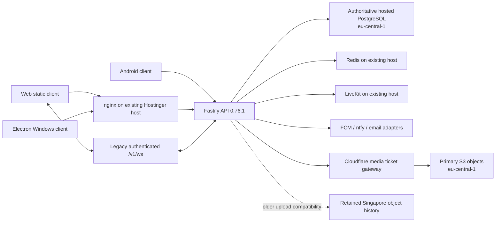

# Meldiq current architecture

Audit date: 4 November 2026, Asia/Shanghai. This is a read-only inventory. No deployment, database query, migration, configuration change or production account write was performed in Part 1.

## Deployment baseline

The running API, Web symlink, database mode and selected non-secret flags were inspected over the existing SSH connection. The records are [runtime inventory](evidence/meldiq-runtime-20261104.json), [final runtime check](evidence/meldiq-runtime-final-20261104.json), [safe flags](evidence/meldiq-safe-flags-20261104.json), [public catalog](evidence/meldiq-public-catalog.json) and [Web source comparison](evidence/web-source-comparison.json). Selected container identities, active symlinks and public Web configuration were unchanged between 04:56 and 05:44 UTC. Presence of an environment variable or package alone does not establish an operational feature.

| Surface | Observed baseline | Evidence and qualification |
| --- | --- | --- |
| API | `0.76.1`, image `griip-internal-messaging-api:0.76.1-pg-b9e6f005-locales-cc61eb40-5facb4c` | Running image ID `sha256:6fe6ef9beb98aa14d2cc3e264d1392a0e76ba6aefe26ba9029342950f2f67f03`; healthy at observation. Image ID is a stronger identity than an old host source directory. |
| Web | `0.5.0-beta-ui-standardization-3cc3c03` | Active `/opt/meldiq-web/current`; exact source `3cc3c032b973ef9f03b7a2c95593cface27e6f32`; [release receipt](../../deploy/ui-standardization/production-receipt.json). Browser sign-in chooser also inspected. |
| Public website | `site-20261103T181028Z-a07de9ec4e` | Active `/opt/meldiq-site/current`; owning workspace `/Volumes/code_files/meldiq_landing_website`. Separate site from Web. |
| Central admin | `1.7.0-plus-361ea0f` | Active `/opt/meldiq-admin/current`; owning workspace `/Volumes/code_files/meldiq_central_admin`. No privileged user session exercised. |
| Windows | Stable 0.3.0 publication documented | [Owning release report](/Volumes/code_files/meldiq_windows_release_activation/docs/desktop/WINDOWS_0_3_0_RELEASE.md), installer hash and feed therein. Installer/device behavior was not rerun in Part 1. |
| Android | Source version 0.5.5, versionCode 34 | `/Volumes/code_files/meldiq_android/android/app/build.gradle.kts`; source HEAD `c111376c` at inspection. Installed/public binary parity unverified. |

### Source drift that later parts must preserve

The shared Web working copy is on `9ded695a`, with many pre-existing tracked and untracked changes. Comparing `src`, package/configuration and workflows against the active Web source found **616 identical files, 59 different files and 21 release files absent from this working copy**. These counts exclude extra local files. See the complete comparison JSON.

Absent release files include order history, gifts, embedded-card capability components, staged sign-in checks and appeal access. Their absence here is not a production feature gap. Use `git show 3cc3c03:<path>` or the existing release worktree `/private/tmp/meldiq-ui-standardization-production` to inspect deployed Web source. Do not publish this older shared tree wholesale. The host's `/opt/griip-internal-messaging/server/package.json` reports 0.70.0, while `/app/package.json` inside the running container reports 0.76.1. Do not treat that host folder as the current backend.

## Region and topology

The planning model is **one primary application deployment and one authoritative Frankfurt PostgreSQL database**, with no verified regional gateway fleet, regional application databases or cross-region application synchronization. Multi-region application architecture remains planned and is outside this program.

The live PostgreSQL pool endpoint identifies `eu-central-1`; the running API sets `S3_REGION=eu-central-1`. This supports Frankfurt database and primary object storage. It does **not** establish Germany-only processing for every component.

There is a material discrepancy to retain: the user's stated baseline is a single-region deployment in Frankfurt. The owning [storage cutover report](/Volumes/code_files/meldiq_messaging_latency_release/docs/infrastructure/migration/production-cutover-report.md) says the API remained on a separate Hostinger VPS, whose IP geolocated to Kuala Lumpur, and explicitly says API host relocation had not occurred. Part 1 confirmed the same existing API host and container, but did not establish its physical location from the hosting provider. **Provider-confirmed API/LiveKit/ntfy compute region remains unfinished.** IP geolocation is not authoritative hosting evidence. Do not convert either this discrepancy or the global CDN into a claim that multi-region gateways or regional database synchronization exist.

The same cutover report retains Singapore object history and an older-client upload compatibility path. That is transitional storage compatibility, not a second application region. Cloudflare globally delivers media and hosts independent status functionality. SES/FCM and OAuth are external services with their own processing locations; no EU-only residency claim is supported.

## Component classification

`DEPLOYED` means observed running or tied to the active immutable release, not complete feature acceptance. `PARTIALLY DEPLOYED` means an active path has known configuration or acceptance limits. `CONFIGURED BUT NOT DEPLOYED` covers optional code or configuration without an active production integration. `PLANNED` and `DEPRECATED` are explicit dispositions, not instructions to delete anything.

| Component | Classification | Actual implementation and evidence | Limits / next owner |
| --- | --- | --- | --- |
| Browser UI | DEPLOYED | React 19.3.1, TypeScript, Next 16.4.3 Pages Router; `next.config.mjs` uses static export. `src/pages/index.tsx` loads the client root. nginx serves static output and application path fallback. | Next is a build/router dependency here; it is not the production API server. Part 2 owns shell primitives. |
| Service worker / offline store | DEPLOYED | Vite builds the service worker; IndexedDB via `idb`; device sessions, snapshots, outbox and key material have existing lifecycle code. | Preserve account isolation, migrations and outgoing data. Cross-device acceptance not run. |
| REST backend | DEPLOYED | Node >=22, Fastify 5.12.7, Zod; domain modules, `/v1` and `/v2`; separate `/admin/v1` registration. Runtime package was read inside the container. | Exact local backend checkout includes later work and is not automatically the running image. |
| Primary database | DEPLOYED | Hosted PostgreSQL through `pg` 8.23.1 and a TLS-verified Supabase session pool in `eu-central-1`; mode string `supabase`; current health `postgres:true`, `mongodb:null`. Pool size flag 6. | No production database queries or row exports in this audit. Do not re-run old migration scripts. |
| PostgreSQL compatibility repositories | DEPLOYED | Backend `src/infrastructure/database/postgres/config.ts` returns `deliveryMode: legacy`; PostgreSQL `Rows` and document-store adapters preserve existing APIs. | A file named `mongoStore.ts` may have a PostgreSQL branch; filenames do not establish Mongo authority. |
| MongoDB Atlas authority | DEPRECATED | Current API disables Mongo in `supabase` database mode; health reports Mongo inactive. Atlas and historical backups were retained by previous migrations. | Retention/rollback artifacts remain protected. No deletion authorized. |
| SQLite authority | DEPRECATED | `better-sqlite3` remains in runtime dependencies and legacy compatibility/cache code. Earlier SQLite-backed deployments and fixtures remain in source. | Package presence does not mean customer domains remain authoritative in SQLite. Exact residual runtime cache usage was not fully inventoried. |
| Redis | DEPLOYED | Redis 8 container running and healthy; API `REDIS_URL` configured; health `redis:true`. | Shared transport/rate-control support is not cross-region replication. |
| Existing account authentication | DEPLOYED | Account/device sessions, email/password, passkeys, recovery, device approval and 2FA source paths; current browser shows Google, Discord, email and passkey choices. | Real provider consent, recovery and new-device key restoration not exercised. Keep existing credentials and identity. |
| Social sign-in broker | PARTIALLY DEPLOYED | Public `/v2/auth/social/config` returned Google and Discord, with Web authorization origin. Backend social configuration uses hosted Supabase Auth endpoints as a provider adapter, then existing Meldiq device/session grants. | This is distinct from migrating all users to native Supabase JWT auth. Final human consent/return acceptance remains open. Apple support in source is not a live offered provider. |
| Native Supabase Auth migration | CONFIGURED BUT NOT DEPLOYED | Optional identity/device-proof modules and staged Web preview code exist. Active public Web configuration has `supabaseMigration:false`. Preview schema restricts activation to staging. | Do not enable as a parity task. Part 2 preserves existing account flows. |
| Realtime messaging | DEPLOYED | Custom `@fastify/websocket` `/v1/ws`; browser sends session token in the first auth frame; native clients may use Authorization on upgrade. Durable device queue, acknowledgements, reconnect and presence paths remain. | Client reconnect backoff, ping and stale detection are source verified, not network failure tests in this audit. Part 3 owns message delivery. |
| Native Supabase Realtime | CONFIGURED BUT NOT DEPLOYED | `src/realtime/supabaseEvents.ts` defines invalidations/recovery; optional native server transport exists. No active native transport setting was found; database configuration retains legacy delivery. | SDK dependency and SQL/outbox code do not prove an active browser subscription. |
| Voice/video SFU | DEPLOYED | LiveKit server v1.13.10 running; API health `livekit:true`; Web client `livekit-client` 2.22.3, server SDK 2.19.1; existing call manager and key-verification UI. | Health is not microphone/camera/screenshare delivery. TURN, physical devices and multi-party quality were not tested. Part 4 owns calls. |
| Object storage | PARTIALLY DEPLOYED | AWS S3 `eu-central-1` configured; owning cutover report confirms Frankfurt primary and legacy Singapore compatibility; current legacy Web upload proxy flag true. | Transitional client paths, retained history and actual authenticated delivery require targeted acceptance. No migration in this program. |
| Private media delivery | DEPLOYED | Existing Cloudflare Worker at `media.meldiq.app`, opaque short-lived tickets and API reauthorization, ranged S3 reads; owning [architecture report](/Volumes/code_files/meldiq_messaging_latency_release/docs/infrastructure/migration/cloudflare-media-architecture.md). | This audit did not issue a ticket or fetch private media. No bearer URLs retained. |
| Attachment retention / encryption | PARTIALLY DEPLOYED | `ATTACHMENT_KEEP_FOREVER=true`; cutover report distinguishes published attachments from drafts/backups. Existing v2 attachment references expose keys to the relay. | Do not call the entire media relay server-resistant E2EE. Verify text, attachment, call and backup modes separately. |
| Android push / ntfy | PARTIALLY DEPLOYED | FCM project/service-account configuration present; ntfy v2.31.1 healthy. Kotlin build conditionally enables Firebase and gates release builds. | Configuration and container health do not establish actual handset background delivery. |
| Browser background push | PARTIALLY DEPLOYED | Web Push/Firebase client and service-worker code exist, but active `/config.json` has no Firebase Web configuration. | Current Web cannot register its configured FCM background path; foreground notifications are separate. Part 3 acceptance item. |
| Email | PARTIALLY DEPLOYED | SES, SMTP and Nodemailer configuration/adapters exist in running API. | Delivery, recovery email timing and spam placement not tested. |
| Billing/catalog | PARTIALLY DEPLOYED | Live PayPal mode. Public catalog: Free 50,000,000-byte uploads / 2,000 chars; Plus USD 4.99 monthly / 1,000,000,000 bytes / 8,000 chars / advertised 1440p60 / 2 included Sparks; Spark USD 0.99 one-time; Bots+ USD 3.99. Monthly available; quarterly/yearly unavailable; gifts flag true. | Entitlement enforcement is reported by catalog, not measured delivered quality. No purchase, renewal, refund or webhook test performed. Part 4 owns commerce contract and lifecycle. |
| Embedded/saved cards / recurring cards | CONFIGURED BUT NOT DEPLOYED | Components exist in active Web source, but advanced checkout, vault and card-recurring flags are all false. | Preserve gates. Existing test doubles do not prove real 3DS or settlement. |
| Bots / integrations | PARTIALLY DEPLOYED | Existing official-bot forms, developer/OAuth UI, webhook and bot domain routes in source; catalog and active Web release include the surfaces. | Part 1 did not install/run a Meldiq bot or grant OAuth access. Provider integrations depend on configuration. |
| Android client | PARTIALLY DEPLOYED | Native Kotlin/Jetpack Compose, local database, notifications and call integration in consolidated `/Volumes/code_files/meldiq_android/android`. | Current source is not an APK deployment receipt. Signing, Play/direct distribution and physical-device parity remain open. |
| Windows client | PARTIALLY DEPLOYED | Electron 45 wrapper, bundled Web workspace, `electron-updater`, Ed25519 release metadata. 0.3.0 stable publication is documented in owning release report. | Authenticode, physical Windows tests and real OAuth/payment lifecycle remain open. Do not call Ed25519 metadata trusted publisher signing. |
| iOS / macOS / Linux native Meldiq distributions | PLANNED | No current shipping release was established in this audit. An iOS directory exists; Windows project can produce development macOS output. | Directory/build target presence is not a released app. Part 4 owns release evidence. |
| nginx / Docker deployment | DEPLOYED | Existing host proxies same-origin API/WebSocket traffic; API, Redis, LiveKit and ntfy containers observed. Web/site/admin immutable release symlinks are active. | No nginx reload, Docker restart or deployment was run. |
| CI checks | CONFIGURED BUT NOT DEPLOYED | Active-release workflow source includes typecheck, lint, formatting, unit tests, i18n and build. Separate Supabase workflow exercises isolated synthetic schema tests. | CI is not a production deploy pipeline. Recent release receipts contain prior check results; no CI run was started here. |
| Release automation / backups / monitoring | DEPLOYED | Existing guarded publish scripts, expected-predecessor checks, shared release locks, immutable chunks and rollback paths; encrypted backup, cleanup, metrics and timing timers observed. | Last backup restore and service SLOs were not rerun. Health snapshots are not uptime or load tests. |
| Multi-region gateways / regional DBs / synchronization | PLANNED | No such active topology was established; no federation settings appeared in the API's selected configuration. | No multi-region work is authorized in Parts 2–4. |

## Boundaries for the implementation parts

Part 2 owns shared navigation, accessibility primitives, auth/onboarding presentation and profile experience. Part 3 owns messaging/realtime, social/community state, permissions, discovery, notification policy and moderation. Part 4 owns call/media/storage adapters, bots/integrations, payment lifecycle and final release integration. Domain owners retain backend enforcement even when a shared Part 2 component renders their controls.

All three parts must start by recording the then-active release and worktree status. Baselines can change after this dated audit. They must keep existing Web/Android/Windows protocol compatibility, preserve pending messages and encryption keys, and use the current PostgreSQL authority. Architecture verification does not authorize infrastructure or production database changes.

## Still unfinished

- Provider-confirmed physical region of API, LiveKit and ntfy compute; reconcile the user's Frankfurt baseline with the owning Hostinger report.
- Full deployed backend source manifest against the running image, including exact post-base overlays; local source and container source are not interchangeable.
- Residual SQLite/cache inventory, current managed database schema/index inspection, backup restore and capacity/SLO evidence.
- Authenticated Meldiq browser journeys and installed Android/Windows parity. No production user data was changed to obtain these.
- Real OAuth consent, push delivery, calls/media, payments/3DS, signed webhooks and lifecycle acceptance.

See [PROJECT_CONTROL.md](PROJECT_CONTROL.md) for status definitions and [IMPLEMENTATION_ROADMAP.md](IMPLEMENTATION_ROADMAP.md) for the proposed implementation order.
