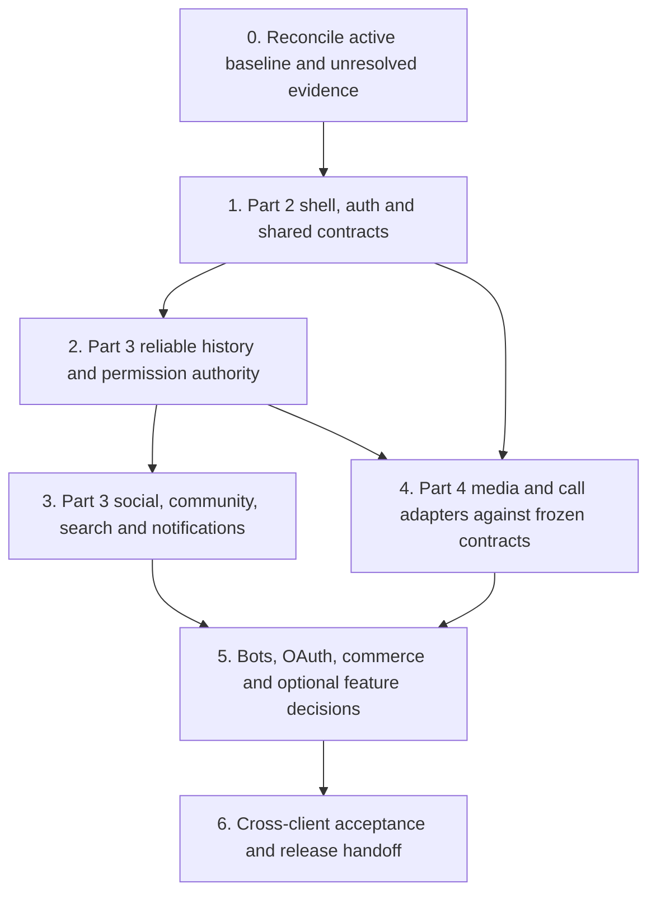

# Implementation roadmap

This is the proposed order for Parts 2–4. No implementation or release begins in Part 1. Work starts from the **then-current production source**, preserving the capabilities that are newer than the shared working copy. See [architecture](CURRENT_ARCHITECTURE.md) and [project control](PROJECT_CONTROL.md).

## Part 3 implementation checkpoint

Part 3 has reviewed all 212 owned rows and delivered source commits, regression evidence and explicit remaining work. Read [the report](handoffs/PART_3_REPORT.md) and [contracts](part3/CONTRACTS.md). Local fixes cover read-boundary ordering, retry-safe friend acceptance, current-authority aggregate search/summary, truthful search errors and DST calendar filters. Existing history, communities, roles, moderation, events and lobby implementations were reused.

11 rows are locally accepted, 185 retain implementation with incomplete acceptance and 16 need product/authority decisions. These states do not change the historical existing-capability column or imply a production rollout. Phase 2/3 final acceptance is bounded by the [per-row review](part3/FEATURE_REVIEW.md); exhaustive server-side filtered search and the listed event/audit/optional program extensions remain open.

Next, Part 4 must reconcile the active production predecessor/overlay, apply the compatible Web/API source changes, consume frozen authority on media/call/bot paths, verify actual native/provider/push behavior, resolve approved optional contracts and build/release with test-linking disabled. Keep all 356 unowned rows and current billing/auth/privacy contracts intact.

## Sequence and dependencies

After shared contracts are agreed, independent domain work can proceed in separate future conversations. This does not authorize overlapping edits to the same shell, router, permission resolver or protocol schema. Part 4 may investigate device/provider blockers early, while dependent implementation waits for the relevant contract.

| Phase | Primary owner | Feature scope | Prerequisites | Exit evidence |
| --- | --- | --- | --- | --- |
| 0: Baseline and evidence | Each part for its rows; Part 4 maintains release identity | All rows; INV tickets | Record active Web/API/native source and dirty changes. Preserve current billing, appeal, staged sign-in, callback and rules-channel work. | Concrete source/release manifest; claimed feature IDs; only relevant open investigation tickets reopened. |
| 1: Shared experience | Part 2 | WEB, AUTH, PROFILE, LOOK, PREF, SHELL, TRUST | C-AUTH/C-KEYS/C-SHELL/C-NAVIGATION/C-PROFILE; fresh-user evidence where needed | Existing login/provider/passkey/recovery paths preserved; empty/loading/error/permission states and mobile focus/back work; no automatic rewrite. |
| 2: Message reliability and authority | Part 3 | MSG-001, MSG-011–016, MSG-025–033; SEARCH-005/011; ROLE/PERM/GATE/MOD P0 cases | Account identity, stable navigation, exact current PostgreSQL implementations | Deterministic cursors, bounded history windows, read/unread boundaries, revoked-session isolation, server-enforced privacy/role matrix; isolated failures and retries accepted. |
| 3: Social and communities | Part 3 | SOCIAL, COMM, CHANNEL, LOBBY, EVENT, SEARCH, NOTIFY, remaining MOD | C-MESSAGE/C-HISTORY/C-COMMUNITY/C-PERMISSIONS accepted | Two controlled accounts complete DM/group/join/onboarding and authorized moderation. Existing features accepted before new controls added. |
| 4: Media and calls | Part 4 | MEDIA, EXPR, VOICE | Message/permission/entitlement contracts; original fixtures; device access | Actual upload/playback/download/range/revocation and mute/capture/share/device-failure tests; measured delivered quality; no unsupported E2EE claim. |
| 5: Integration and optional products | Part 4, with domain owners | BOT, BOTOPT, DEV, BILL, API, BOTEVENT, GATEWAY, OPS | Domain authority, review/credential/commerce contracts, relevant user product decisions | Real bounded bot/webhook/OAuth and approved payment lifecycle evidence; optional undecided capabilities stay disabled/deferred. |
| 6: Final acceptance and release | Part 4 | RELEASE plus accepted rows across all parts | Versioned source/artifacts, current predecessor, relevant P0 acceptance, accurate copy and monitoring | Reconciled feature register, Web/Android/Windows evidence, rollout/rollback plan and authorized release scope. Release is not inferred from Part 1. |

## Part 2 handoff

1. Read the active `3cc3c03` source and source-comparison file before editing this older shared tree. Keep existing orders, gifts, account appeals, card capability gates and staged sign-in controls even where files are absent locally.
2. Verify existing UI first: searchable settings, navigation groups, comfort/accessibility controls, per-community identity, cosmetics and account switcher already have source. Do not build replacements from the old audit's missing-feature labels.
3. Finish INV-001/003 with the user. First registration, verification/resend and first-ever onboarding are not established by the returning research session. Preserve every existing sign-in and legitimate key-restoration route.
4. Freeze shared primitives and navigation hooks before Parts 3/4 consume them. Profile upload UI uses Part 4's media contract; comments are a Part 3 domain if separately approved.
5. Resolve profile section ordering/visibility and optional appearance granularity as small scoped decisions. Clips, soundboard hosting and billing are not a justification for a major shell redesign.

Accept in isolated/browser fixtures: desktop and 390/768 widths, keyboard/back/focus, unsaved changes, provider cancel/error, expired/revoked sessions and account isolation. Real provider consent and physical devices are separate evidence.

## Part 3 handoff

1. Reproduce current behavior before treating earlier pagination/anchor/CORS observations as current production bugs. Backend PostgreSQL and Web source have changed since 1 November.
2. Prioritize durable messages, deterministic tie-safe pagination, contiguous versus disjoint history, unread/read markers, retry and membership revocation. Do not replace a reliable existing outbox to imitate competitor scrolling.
3. Keep Meldiq's canonical permission catalog. The register maps 29 direct semantic leads; `move_members`, `manage_events` and blanket `administrator` require special review. A competitor permission name is not a new Meldiq grant.
4. Use a controlled non-owner account for friendship/group/privacy/onboarding/private-channel and role-conflict tests. Owner-only observations do not establish member/moderator enforcement.
5. Preserve existing communities, forum/thread content, rules channels, Saved/Reminders and notification inheritance. Accept the existing lobby and bot-connected cards before adding more templates.
6. Establish event/recurrence/RSVP semantics and background notification reality. Active Web Firebase configuration is absent in the observed release; foreground UI and native push are separate paths.

Part 3 supplies effective authorization to Part 4 for media tickets, voice moderation, bot actions and community entitlements. Domain checks cannot be replaced with disabled buttons.

## Part 4 handoff

1. Verify current LiveKit, S3 Frankfurt/media gateway and legacy compatibility paths. Health checks and configuration are evidence of infrastructure presence, not actual media delivery.
2. Preserve the current catalog and units. At observation Plus is USD 4.99/month, 1 GB decimal upload limit and 8,000 characters; Spark is USD 0.99 one-time. Never apply the superseded old research target or competitor limits automatically.
3. Keep advanced cards, saved cards and recurring cards disabled. Existing card components in release source are capability-gated. Real approved buyer, 3DS and signed-webhook/lifecycle evidence remain open.
4. Build on existing official-bot, webhook, developer and OAuth domains. The 76 bot API operations, 13 event types and 10 gateway frames are **research candidates**, not an instruction to copy Yapin URLs or implement all vendor compatibility.
5. Obtain explicit decisions for optional hosted bot execution, soundboard, recording/clips/report buffers, creator settlement and new paid placement. Preserve Meldiq's current no-clips posture and constrained delegation model until decided.
6. Own current-source/native parity, status integration and final release evidence. Reconcile compute-region evidence without moving infrastructure. Retained Singapore object compatibility is not permission to start a multi-region migration.

## Shared integration points

| Overlap | Single owner | Consumer agreement |
| --- | --- | --- |
| Shell, router, settings registry, generic dialogs | Part 2 | Domain owners provide labelled destinations and state/availability hooks; Part 2 keeps global focus/back/mobile rules. |
| Composer and message lifecycle | Part 3 | Part 4 supplies typed expression/media drafts and completion/cancel callbacks; no second send pipeline. |
| Identity and profile projections | Part 2 | Part 3 filters community/social visibility; Part 4 validates bytes and asset ownership. |
| Permission resolution and moderation | Part 3 | Part 4 enforces the same result on tokens, tickets, bots and live tracks. |
| Entitlement catalog and payments | Part 4 | Part 2 renders account surfaces, Part 3 consumes effective community limits. No client hardcodes product grants. |
| Notifications and activity | Part 3 | Part 4 supplies real call/bot/payment events with stable IDs; shared retry cannot duplicate notices. |
| Native release acceptance | Part 4 | Parts 2/3 supply compatible payloads and accepted feature IDs; native source presence does not count as shipping. |

## Release gates and remaining investigation

No estimated dates or completed percentages are invented. The CSV/progress ledger must name each actual source, test environment and remaining issue. Source-only features remain unaccepted until their relevant tests pass. Documentation-only, restricted and optional items may be deferred explicitly instead of holding unrelated accepted work.

Before any later release: record the latest production predecessor, preserve newer client/server assets and callback contracts, confirm relevant P0 cases, validate public claims and exercise version-aware rollback without restoring old customer data over newer writes. This research assignment authorizes no production release, database migration or account mutation.

All unresolved investigation remains in [INV-001–018](PROJECT_CONTROL.md). The next parts can use the existing routes, screens, raw observations and feature IDs, and repeat only the relevant unresolved scenario rather than the full competitor investigation.
